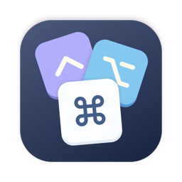

<p align="center">
  
</p>

<h1 align="center">Keyfold</h1>

<p align="center">
  Every keyboard shortcut on your Mac, in one searchable list.
</p>

---

Mac apps each hide their shortcuts in their own menus, and you only learn them one app at a time. Keyfold asks every app you have running and shows all of their shortcuts in a single window, in the glyphs you already know (⌘⇧⌥⌃), so you can search for a key, a command or an app instead of hunting through menus.

## What you get

- **All running apps at once.** Keyfold reads each app's menu bar and lists every shortcut with its menu path, for example `⌘C  Copy · Edit › Copy`.
- **Search that understands keys.** Type `ctrl shift c`, `copy` or the app name. Modifier words and glyphs both work.
- **Group by app or by shortcut.** The second view collects the same combo across apps, so you can see where the same keys do different things.
- **macOS system shortcuts.** Mission Control, Spaces, VoiceOver, Dock hiding and the others you have switched on, listed under "macOS".
- **Menu-bar apps included.** Apps that live only in your menu bar are listed with the shortcuts their menu shows, and global hotkeys that Keyfold can read from apps such as Shottr, Supercharge, Rectangle and Raycast.
- **Unreadable apps are labelled**, not silently dropped.

## Install

```bash
brew tap joshmuthumani/apps
brew install --cask joshmuthumani/apps/keyfold
```

Update later with `brew upgrade --cask joshmuthumani/apps/keyfold`. Remove with `brew uninstall --cask joshmuthumani/apps/keyfold`.

Prefer not to use Homebrew? Download `Keyfold-<version>.dmg` from the [Keyfold releases](https://github.com/joshmuthumani/homebrew-apps/releases?q=keyfold-v&expanded=true), open it and drag Keyfold to Applications. Releases before 0.3.0 have a zip instead: unzip it and drag Keyfold to Applications.

**Requirements:** an Apple Silicon Mac (M1 or newer) running macOS 26 or newer.

## First launch

Keyfold needs the macOS **Accessibility** permission, because that is how it reads other apps' menus. On first launch it shows a button, "Open Accessibility Settings". Switch Keyfold on and the list appears by itself.

## Privacy

Everything happens on your Mac. Keyfold reads menu titles and shortcuts, keeps nothing except your Group by choice, and sends nothing anywhere.

## Good to know

- Keyfold scans when you open the window or press Refresh. An app that is not running will not appear: open it, then refresh.
- It lists what apps put in their menus. Keys an app handles inside its own window and never lists in a menu (Figma's `V` for Move, for example) cannot be seen.
- Some apps fill their menus only after you open them, so a few of their shortcuts may be missing.
- A menu-bar app whose icon is hidden (Rectangle with its icon off, for example) shows only what its saved settings reveal.
- macOS blocks reading some sandboxed apps' settings; those apps still show what their menu lists.
- Keyfold is notarized by Apple but is not on the Mac App Store: reading other apps' menus is not allowed in the App Store sandbox.

## Coming next

Conflict detection that flags two apps fighting over the same keys, and more global-hotkey sources (Karabiner, FluidVoice).

## Releases

- [**0.3.0**](https://github.com/joshmuthumani/homebrew-apps/releases/tag/keyfold-v0.3.0) (2026-10-17): a disk image to download, shortcuts in a clear accent colour, group headers that stay in view, View menu commands, and a simpler permission screen.
- [**0.2.0**](https://github.com/joshmuthumani/homebrew-apps/releases/tag/keyfold-v0.2.0) (2026-10-16): macOS system shortcuts, shortcuts from menu-bar apps' status menus, global hotkeys you have changed in Shottr, Supercharge, Rectangle and others, Raycast's main hotkey, and a new icon.
- [**0.1.0**](https://github.com/joshmuthumani/homebrew-apps/releases/tag/keyfold-v0.1.0) (2026-10-16): first test release. Lists the menu-bar shortcuts of every running app, with search and grouping.

## Feedback

This is an early release for a small group. Please [open an issue](https://github.com/joshmuthumani/homebrew-apps/issues) with what you see, including the app that misbehaved and your macOS version.

© 2026 Josh Muthumani. All rights reserved.
